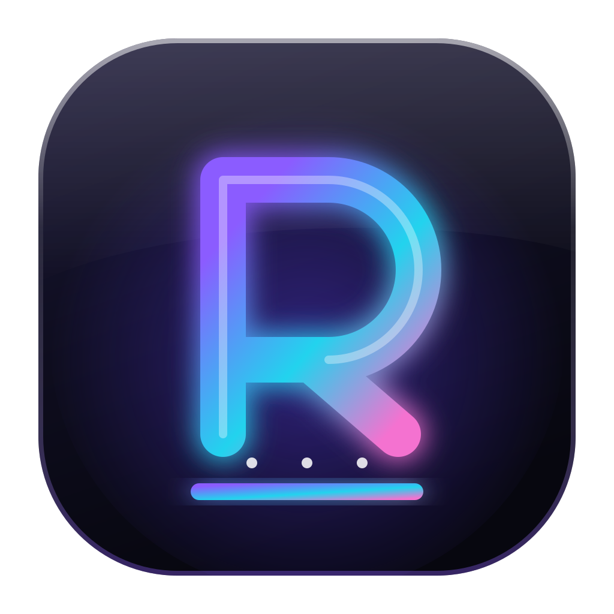

<p align="center"></p>
<h1 align="center">REZ</h1>
<p align="center">Dock « Expo-Glass » pour Windows : remplace la barre des tâches. Tauri 2 · Rust · TypeScript.</p>

---

## Télécharger (utilisateurs)

👉 **[Dernière version](https://github.com/reztsk/rez-dock/releases/latest)** → `REZ_x.y.z_x64-setup.exe` → lancer.
Pas besoin de droits admin. REZ se met à jour tout seul : une notification s'affiche au-dessus du dock → **Mettre à jour**.

## Fonctionnalités

| | |
|---|---|
| **Remplace la barre Windows** | `Shell_TrayWnd` masquée dès le lancement, zone de travail réservée au dock, barre native restaurée à l'identique en quittant. Démarrage auto avec Windows en option. |
| **Compact & libre** | Préréglage discret (barre de 50 px, centrée en bas), échelle globale 50–250 %, bord Bas/Haut/Gauche/Droite ou placement libre (glisser le fond du dock, aimantation aux bords). |
| **Bouton Démarrer** | Logo Windows minimaliste → ouvre le vrai menu Démarrer. |
| **Expo-Glass** | Vrai flou du bureau (fenêtre DWM blur/acrylique dont la forme suit la barre en temps réel) + teinte, reflets, bordure néon en CSS. |
| **Magnification** | Vague cosinus façon macOS, lissage indépendant du framerate, boucle rAF qui s'arrête au repos (0 % CPU). |
| **Animations** | Slide/fade d'entrée et de sortie, rebond au lancement, impulsion au clic, FLIP en drag & drop. |
| **Modules** | Démarrer, Recherche, Vue des tâches, apps épinglées, apps ouvertes, séparateurs, icônes cachées, horloge, notifications, bureau, corbeille, réglages. Activables / réorganisables. |
| **Drag & drop** | Glisser dans la barre pour réordonner · glisser vers l'intérieur de l'écran pour retirer · déposer un `.exe/.lnk/.url` pour épingler. |
| **Icônes cachées** | Flèche ^ intégrée : apps de la zone de notification + processus en arrière-plan (ouvrir, emplacement, terminer). |
| **Mode gaming** | Jeu plein écran détecté → le dock glisse hors de l'écran, ses fenêtres sont masquées, tout polling s'arrête. |
| **Auto-update** | Releases GitHub signées (minisign), installeur NSIS passif, redémarrage auto. |

### Sécurité anti-cheat (Vanguard, BattlEye, EAC…)

REZ n'utilise **que** des API fenêtrées publiques :

- Détection plein écran : `GetForegroundWindow`, `GetClientRect`, `MonitorFromWindow`, `SHQueryUserNotificationState`.
- Liste des fenêtres : `EnumWindows`, `GetWindowText`, `QueryFullProcessImageName` (droit *limited query*, comme le Gestionnaire des tâches), jamais pendant qu'un jeu est plein écran.
- Icônes cachées : registre `HKCU\Control Panel\NotifyIconSettings` + `CreateToolhelp32Snapshot` (noms de processus).
- **Jamais** : `ReadProcessMemory`/`WriteProcessMemory`, hooks (`SetWindowsHookEx`), injection DLL, overlay dans le jeu, accès aux fichiers du jeu.

## Développement

### Prérequis

- Windows 10 21H2+ / Windows 11, **WebView2** (inclus dans Windows 11)
- [Rust](https://rustup.rs) stable (`x86_64-pc-windows-msvc`) + Visual Studio Build Tools (C++)
- [Node.js](https://nodejs.org) 20+

### Commandes

```bash
npm install
```

```bash
npm run app:dev
```

```bash
npm run app:build
```

`app:build` signe avec `%USERPROFILE%\.tauri\rez.key` (générée automatiquement si absente). Installeur : `src-tauri/target/release/bundle/nsis/`.

Régénérer les icônes depuis le logo :

```bash
npm run icons
```

### Arborescence

```
src-tauri/src/
  lib.rs          setup Tauri, plugins, filet de sécurité (barre Windows restaurée même sur panic)
  commands.rs     commandes IPC
  config.rs       persistance JSON (%APPDATA%\app.rez.dock\config.json)
  dock.rs         placement fenêtre, surfaces (verre + zones cliquables)
  monitor.rs      threads : mode gaming, fenêtres, click-through
  win/glass.rs    fenêtre de verre natif (DWM accent + SetWindowRgn)
  win/taskbar.rs  masquage réversible barre native + zone de travail
  win/windows.rs  énumération / activation des fenêtres
  win/icons.rs    icônes HD (IShellItemImageFactory → PNG)
  win/tray.rs     icônes cachées + processus d'arrière-plan
  win/appinfo.rs  noms d'apps, raccourcis .lnk, épingles par défaut
  win/shell.rs    lancement, raccourcis système
src/
  dock/           dock (engine = magnification + sync verre, render, drag, popovers, tray, updater)
  settings/       panneau de réglages
  shared/         types, API, défauts/thèmes, icônes SVG, mise à jour
```

## Publication GitHub

### Première fois (crée le dépôt public, configure les secrets, publie v1.0.0)

```bash
powershell -ExecutionPolicy Bypass -File scripts/setup-github.ps1
```

Le script : met l'URL de mise à jour sur ton dépôt, pose la clé publique dans `tauri.conf.json`, crée `TON_PSEUDO/rez-dock` (public), ajoute les secrets `TAURI_SIGNING_PRIVATE_KEY(_PASSWORD)`, pousse `main` et le tag `v1.0.0`. GitHub Actions compile et publie la release + `latest.json`.

### Versions suivantes

```bash
npm run release -- 1.0.1
```

Bump des 3 fichiers de version → commit → tag → push → build + release automatiques. Les REZ installés la proposent au prochain lancement.

> ⚠️ Sauvegarde `%USERPROFILE%\.tauri\rez.key`. Perdue = plus aucune mise à jour possible pour les installations existantes.

## Dépannage

- **Barre des tâches Windows disparue après un arrêt forcé de REZ** : relancer REZ (l'état d'origine est restauré au démarrage puis réappliqué), ou décocher *Masquer la barre des tâches*, ou redémarrer l'Explorateur (`taskkill /f /im explorer.exe` puis `start explorer`).
- **Pas de flou** : *Réglages → Apparence → Intensité du flou* > 0, et *Paramètres Windows → Personnalisation → Couleurs → Effets de transparence* activé.
- **Multi-écrans** : le dock s'affiche sur l'écran principal.

## Licence

MIT
